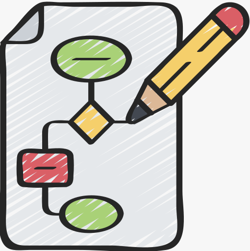
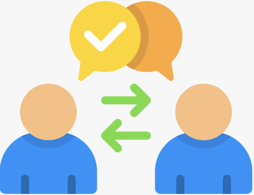
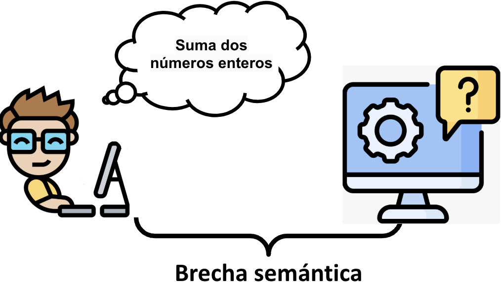
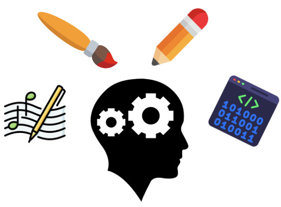
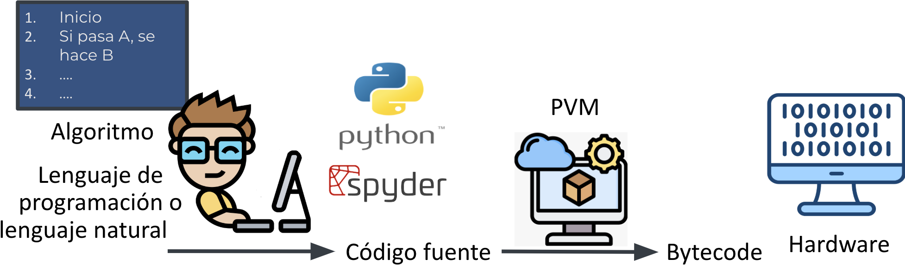

# N1-01 - Descubriendo el mundo de la programación {#sec-n1-01}

## Algoritmo

[Video de contexto](https://www.youtube.com/watch?v=FN2RM-CHkuI) (YouTube)

{fig-alt="Ilustración de un diagrama de flujo dibujado en una hoja, junto a un lápiz." fig-align="center" width="170px"}

- Secuencia de instrucciones
  - Claras y ordenadas
    - Resuelven → Problema
  - Producen → Salida
    - Para → Entrada dada

## Comunicar un algoritmo

- A humanos → Lenguaje natural

{fig-alt="Dos personas intercambian mensajes y se entienden." fig-align="center" width="160px"}

- A computadores → **Lenguajes de programación**

{fig-alt="Una persona frente a un computador piensa «Suma dos números enteros», mientras el computador muestra un signo de interrogación. Entre ambos aparece el texto «Brecha semántica»." fig-align="center" width="480px"}

## Lenguaje y código

- **Lenguaje de programación**:
  - Notación para expresar algoritmos
- **Código fuente**:
  - Instrucciones escritas en ese lenguaje
    - Comprensibles → Humanos
      - Base → Programa

## Programa

- Instrucciones precisas y ordenadas
  - Indican al computador cómo ejecutar
    - Tareas específicas
- **Instrucción**:
  - Comando → Computador interpreta

## Programación

> "Computer programming is an **art**... A programmer who subconsciously views himself as an **artist**, will enjoy what he does and will do it better."
>
> — Donald Knuth

{fig-alt="Silueta de una cabeza con engranajes, rodeada de un pincel, un lápiz, una partitura y una ventana de código." fig-align="center" width="300px"}

## Programador y programación

- **Programador**
  - "Artista" cuyo oficio es la programación
- **Programación**
  - "Arte" de crear un programa

## Lenguaje y algoritmos

- Algoritmos → **Independientes** del lenguaje
  - Se pueden expresar (al menos) en:
    - Lenguaje natural
    - Lenguajes de programación

## Python

- Lenguaje de programación
- **¿Por qué aprender Python?**
  - Es muy importante en la actualidad...

.](img/n1-01-logo-python.png){fig-alt="Logo de Python." fig-align="center" width="150px"}

### Popularidad de los lenguajes (TIOBE)

.](img/n1-01-tiobe-historico-lenguajes.png){fig-alt="Gráfica de líneas del índice TIOBE entre 2001 y 2026 para Python, C, C++, Java, C#, JavaScript, Visual Basic, SQL, R y Rust." fig-align="center"}

.](img/n1-01-tiobe-historico-python.png){fig-alt="Gráfica del índice TIOBE entre 2001 y 2026 con la línea de Python resaltada: sube de cerca del 5 % en 2018 a cerca del 27 % a mediados de 2025 y baja a cerca del 19 % en 2026." fig-align="center"}

### Lenguajes más usados en GitHub (2026)

.](img/n1-01-github-ranking-lenguajes.png){fig-alt="Gráfica de posiciones de los diez lenguajes más usados en GitHub a lo largo del tiempo: JavaScript ocupa el primer lugar y Python el segundo durante todo el periodo, y TypeScript sube hasta el tercer puesto." fig-align="center"}

### Lenguajes que impulsan el desarrollo de IA (GitHub)

.](img/n1-01-github-octoverse-lenguajes-ia.png){fig-alt="Lenguajes más usados en proyectos de inteligencia artificial en GitHub: 1. Python (582 mil repositorios, +50,7 % anual), 2. JavaScript (88 mil, +24,8 %) y 3. TypeScript (86 mil, +77,9 %)." fig-align="center"}

## Semántica y sintaxis de Python

- Python tiene:
  - **Sintaxis** → Cómo _se escribe_ → Código
  - **Semántica** → Qué _significa_ → código

### Ejemplo: suma

- **Sintaxis**:
  - ¿Cómo _se escribe_ en código una suma aritmética?

```python
primer_operando + segundo_operando
```

- **Semántica**:
  - ¿Qué _significa_ el anterior código?
    - El operador `+` implica la suma aritmética
      - Entradas:
        - `primer_operando`
        - `segundo_operando`
      - Salida:
        - Nuevo valor numérico

## El proceso de interpretación en Python

{fig-alt="Diagrama del proceso: una persona expresa un algoritmo en un lenguaje de programación o en lenguaje natural y escribe el código fuente en Python (en el editor Spyder); el código se convierte en bytecode, que la máquina virtual de Python (PVM) ejecuta sobre el hardware." fig-align="center"}

1. Código fuente (**`.py`**) → **CPython** (intérprete estándar de Python)
2. CPython → **bytecode**
3. Bytecode → **PVM** (_Python Virtual Machine_)
4. PVM → **hardware**

**Nota:** En Spyder, el código se ejecuta desde la consola IPython, que funciona sobre CPython.

## ¿Qué pasaría si el código fuente contiene errores?

Consulta las diapositivas de [Errores en Python](https://eerosales24.github.io/iph_2026_20/general/errores_comunes/#/):

- [Error y Excepción](https://eerosales24.github.io/iph_2026_20/general/errores_comunes/#/3)
- [SyntaxError](https://eerosales24.github.io/iph_2026_20/general/errores_comunes/#/4)

## 🌀 Metodología en espiral 🌀

- Conceptos fundamentales
  - Se explican → Múltiples veces
